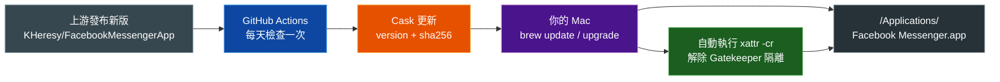

# 用 Homebrew 安裝 Facebook Messenger App（macOS）

[回到 README](README-tw.md) | [English](README-macos-brew.md)

這個 App 沒有 Apple 開發者簽章。直接安裝 DMG 時，macOS Gatekeeper 常會跳出「應用程式已損毀，無法開啟」，你得自己執行 `sudo xattr -cr ...` 才能開啟。

改用 Homebrew 安裝就不用煩惱這件事：

- **安裝或升級完會自動解除隔離**：每次安裝或升級後，cask 都會自動執行 `xattr -cr`。
- **版本自動跟上**：GitHub Actions 每天檢查上游有沒有新版，有的話就自動更新 cask。你只要執行 `brew upgrade`。

> **比喻**：這個 repo 是一間小商店（tap），貨架上有一張「商品說明卡」（cask），寫著去哪裡進貨、怎麼驗貨、上架後要做什麼。GitHub Actions 是每天早上幫忙換說明卡的店員，你只要偶爾來店裡拿新貨就好。

## 運作方式



## 系統需求

- Apple Silicon（M 系列晶片）Mac
- macOS 26 Tahoe 或更新版本
- 已安裝 [Homebrew](https://brew.sh)

## 安裝

```bash
brew tap stzengpx/fbm https://github.com/stzengpx/FacebookMessengerApp
brew trust stzengpx/fbm
brew install --cask stzengpx/fbm/facebook-messenger-app
```

| 指令 | 作用 |
| --- | --- |
| `brew tap` | 把這個 repo 加入 Homebrew 的來源清單 |
| `brew trust` | 新版 Homebrew 預設不載入第三方 tap，要先明確信任 |
| `brew install --cask` | 下載 DMG、比對 SHA256、把 App 裝到 `/Applications` |

安裝最後會**要求輸入一次 Mac 登入密碼**，因為解除隔離的 `xattr` 要用 `sudo` 執行。完成後就能直接開啟 App。

### 如果之前已經用其他方式安裝過

- **手動從 DMG 安裝**：先把 `/Applications/Facebook Messenger.app` 拖到垃圾桶，再執行上面的安裝指令。聊天設定存在 `~/Library`，不會被刪掉。
- **從自己建的 Tap 安裝**（例如 `local/apps`）：先移除舊的 cask，否則同名 cask 會出現在兩個 tap 裡，`brew upgrade` 會無法判斷要用哪一個：

  ```bash
  brew uninstall --cask facebook-messenger-app
  git -C "$(brew --repository local/apps)" rm Casks/facebook-messenger-app.rb
  git -C "$(brew --repository local/apps)" commit -m "Remove facebook-messenger-app"
  ```

  如果那個 tap 裡沒有其他東西，也可以直接執行 `brew untap local/apps`。

## 升級

```bash
brew update                                  # 取得最新的 cask
brew upgrade --cask facebook-messenger-app   # 升級 App
```

升級後會再自動執行一次 `xattr -cr`（也會再要求輸入密碼），升級完一樣能直接開啟。

想先看看有沒有新版：

```bash
brew update
brew outdated --cask                                     # 列出可升級的 cask
brew info --cask stzengpx/fbm/facebook-messenger-app     # 查看已安裝版本與最新版本
```

> App 內建的「有新版本」通知還是會跳出來，但**請改用 `brew upgrade` 升級**，不要手動下載 DMG 覆蓋。手動覆蓋會讓 brew 記錄的版本跟實際版本不一致，而且要自己再執行一次 `xattr`。
>
> 上游發布新版後，最晚約一天內 cask 就會更新。如果剛發布就想升級，`brew outdated` 可能還看不到，等隔天再試即可。

## 移除

```bash
brew uninstall --cask facebook-messenger-app   # 移除 App
brew untap stzengpx/fbm                        # 不再使用這個 tap
```

## 疑難排解

| 狀況 | 解法 |
| --- | --- |
| `Refusing to load cask ... from untrusted tap` | 還沒信任這個 tap，執行 `brew trust stzengpx/fbm` |
| `Unknown command: trust` | 你的 Homebrew 版本比較舊，還不需要這一步，跳過即可。也可以先 `brew update` 更新 Homebrew |
| 開啟時仍顯示「已損毀」 | 可能是安裝時沒輸入密碼，postflight 沒跑完。手動執行 `sudo xattr -cr "/Applications/Facebook Messenger.app"` |
| `brew upgrade` 說找不到或名稱重複 | 同名 cask 還留在其他 tap 裡，參考上面的「從自己建的 Tap 安裝」把舊的移除 |
| 不支援這台 Mac | 目前只有 Apple Silicon、macOS 26 以上的版本，Intel Mac 請改用手動安裝 DMG |

## 常用指令速查

| 目的 | 指令 |
| --- | --- |
| 安裝 | `brew install --cask stzengpx/fbm/facebook-messenger-app` |
| 檢查新版 | `brew update && brew outdated --cask` |
| 升級 | `brew upgrade --cask facebook-messenger-app` |
| 重新安裝 | `brew reinstall --cask facebook-messenger-app` |
| 查看資訊 | `brew info --cask stzengpx/fbm/facebook-messenger-app` |
| 移除 | `brew uninstall --cask facebook-messenger-app` |
