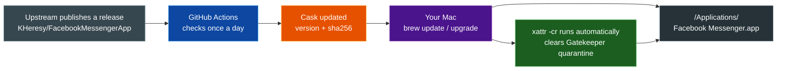

# Install Facebook Messenger App with Homebrew (macOS)

[Back to README](README.md) | [繁體中文](README-macos-brew-tw.md)

This app is not signed with an Apple Developer certificate. When you install the DMG directly, macOS Gatekeeper often says the app "is damaged and can't be opened", and you have to run `sudo xattr -cr ...` yourself before it will open.

Installing with Homebrew takes care of this for you:

- **Quarantine is cleared automatically**: after every install or upgrade, the cask runs `xattr -cr` for you.
- **The cask stays up to date**: GitHub Actions checks upstream for a new release every day and updates the cask when it finds one. You just run `brew upgrade`.

> **Analogy**: This repo is a small shop (a tap). On the shelf is a "product card" (the cask) that says where to get the goods, how to check them, and what to do after they're shelved. GitHub Actions is the clerk who replaces the card every morning. You only drop by now and then to pick up the new version.

## How It Works



## Requirements

- A Mac with Apple Silicon (M-series chip)
- macOS 26 Tahoe or later
- [Homebrew](https://brew.sh) installed

## Install

```bash
brew tap stzengpx/fbm https://github.com/stzengpx/FacebookMessengerApp
brew trust stzengpx/fbm
brew install --cask stzengpx/fbm/facebook-messenger-app
```

| Command | What it does |
| --- | --- |
| `brew tap` | Adds this repo to Homebrew's list of sources |
| `brew trust` | Newer Homebrew won't load third-party taps until you trust them |
| `brew install --cask` | Downloads the DMG, verifies its SHA256, and installs the app into `/Applications` |

At the end of the install, you'll be **asked for your Mac login password once**, because the `xattr` step runs with `sudo`. After that, the app opens normally.

### If you installed the app another way before

- **Manually from the DMG**: move `/Applications/Facebook Messenger.app` to the Trash, then run the install commands above. Your settings live in `~/Library` and are kept.
- **From a tap you built yourself** (for example `local/apps`): remove the old cask first. Otherwise the same cask name exists in two taps, and `brew upgrade` can't tell which one to use:

  ```bash
  brew uninstall --cask facebook-messenger-app
  git -C "$(brew --repository local/apps)" rm Casks/facebook-messenger-app.rb
  git -C "$(brew --repository local/apps)" commit -m "Remove facebook-messenger-app"
  ```

  If that tap holds nothing else, you can run `brew untap local/apps` instead.

## Upgrade

```bash
brew update                                  # fetch the latest cask
brew upgrade --cask facebook-messenger-app   # upgrade the app
```

After the upgrade, `xattr -cr` runs again (and asks for your password again), so the app still opens right away.

To check for a new version first:

```bash
brew update
brew outdated --cask                                     # list casks that can be upgraded
brew info --cask stzengpx/fbm/facebook-messenger-app     # show installed and latest versions
```

> The app's built-in "new version available" notice still appears, but **upgrade with `brew upgrade`** instead of downloading the DMG and overwriting the app. A manual overwrite leaves brew with the wrong version on record, and you'd have to run `xattr` yourself again.
>
> The cask is updated within about a day of an upstream release. If a release just came out, `brew outdated` may not show it yet. Try again the next day.

## Uninstall

```bash
brew uninstall --cask facebook-messenger-app   # remove the app
brew untap stzengpx/fbm                        # stop using this tap
```

## Troubleshooting

| Problem | Fix |
| --- | --- |
| `Refusing to load cask ... from untrusted tap` | You haven't trusted the tap yet. Run `brew trust stzengpx/fbm` |
| `Unknown command: trust` | Your Homebrew is older and doesn't need this step, so skip it. You can also run `brew update` to update Homebrew |
| The app still says it "is damaged" | The postflight step probably didn't finish, for example because the password prompt was skipped. Run `sudo xattr -cr "/Applications/Facebook Messenger.app"` |
| `brew upgrade` can't find the cask or says the name is ambiguous | A cask with the same name is still in another tap. Remove it as described in "From a tap you built yourself" above |
| This Mac isn't supported | Only Apple Silicon Macs on macOS 26 or later are supported. On an Intel Mac, install the DMG manually |

## Command Cheat Sheet

| Task | Command |
| --- | --- |
| Install | `brew install --cask stzengpx/fbm/facebook-messenger-app` |
| Check for a new version | `brew update && brew outdated --cask` |
| Upgrade | `brew upgrade --cask facebook-messenger-app` |
| Reinstall | `brew reinstall --cask facebook-messenger-app` |
| Show info | `brew info --cask stzengpx/fbm/facebook-messenger-app` |
| Uninstall | `brew uninstall --cask facebook-messenger-app` |
